# PR #1 の DB は、どのルールを守り、どこで破れるか

> 想定読者：PR #1（feat(db): DBスキーマと初期データ投入）の作者本人。Claude と一緒に書いた設計を、自分でレビューしてからマージしたい人。
>
> 省いたもの：カラムの一覧（`docs/database.md` にある）、PostgreSQL・Drizzle・セットアップの説明。
>
> 所要時間：10 分。
>
> 検証方法：本文の出力はすべて、PR #1 の `0000_init.sql` と `seed.ts` を使い捨ての DB（`db_review_explainer`）に流して実行した結果を貼ったもの。`verify-doc.mjs` が再実行して照合している。

この資料は、PR #1 のスキーマが DB で守る 3 つのルールは期待どおり違反を拒否するが、設計書の手順のうち 2 つは同時実行で壊れ、seed にも README と食い違う動きが 1 つあることを伝える。

この 3 か所は、同じ PR の後続のコミットで直した（6 節）。各節は「修正前の動き → 修正後の手順」の順に書いている。

読み終えたら、次の 3 つを判定できるようになる。

1. PR #1 をこのままマージしてよいか。直すならどこにコメントするか。
2. どのルールが DB で守られ、どのルールが Service の実装に残っているか。
3. API を実装するとき、設計書のどの手順に従えば競合を防げるか。

| 節 | 役割 | 見せるもの | なぜ |
|---|---|---|---|
| 0 | レビュー結果を 1 枚にする | 判定表 | マージ可否を最初に決められるように |
| 1 | テーブルのどこにルールがあるかを示す | 関係図 | 2〜4 節の実験がどの表の話かを追えるように |
| 2 | DB が拒むものと受け入れるものを分ける | 01 の出力 | 「DB にある」と「Service に残る」の境目を見せる |
| 3 | 災害の終了とチェックインの競合 | 02 の出力 | 修正前の手順の穴 1 |
| 4 | 初回入庫の競合 | 03 の出力 | 修正前の手順の穴 2 |
| 5 | seed の再実行 | 04 の出力 | README との食い違い |
| 6 | コメント案 | チェックリスト | そのまま PR に書ける形にする |

## 0. 一枚で

**結論：スキーマはマージしてよい。マージ前に直すべき 3 か所（`docs/database.md` の手順 2 つと `seed.ts`）は修正済みで、残りは「確認」の 3 行を決めるだけ。**

| 診断項目 | 実測値 | 合格基準 | 判定 | 次アクション |
|---|---|---|---|---|
| PR に書いた 3 つの DB 制約（active 1 件・滞在 1 人 1 件・在庫 ≥ 0） | 3 つとも拒否（23505 / 23505 / 23514） | PR 本文の「確認したこと」 | OK | なし |
| 災害の終了とチェックインが同時に走る | 修正前の手順で 1 件、修正後（`FOR SHARE`）で 0 件が closed な災害に残った | 設計書「終了時は滞在中のチェックインをすべてチェックアウトする」 | OK（修正済み） | API 実装で修正後の手順に従う |
| 在庫の行がない物資に 2 人が同時に入庫 | 修正前の手順で 2 人目が 23505・在庫 100、修正後で在庫 150 | 2 人分が入って 150 | OK（修正済み） | API 実装で修正後の手順に従う |
| デモ用災害を終了したあと seed を再実行 | active 1, closed 1 | README「active な災害がない場合のみ active で 1 件作成する」 | OK（修正済み） | なし |
| closed で `ended_at` が NULL・チェックアウトがチェックインより前 | どちらも受け入れた | 文脈による | 確認 | CHECK を 2 本足すか決める（足すと拒否できることは実験済み） |
| closed な災害へのチェックイン | 受け入れた | 文脈による | 確認 | Service で守る前提でよいか決める |
| seed の在庫と履歴 | 在庫合計 4730 / 履歴 0 行 | 文脈による | 確認 | 履歴から在庫を再計算する運用をするなら、seed でも IN を入れる |

## 1. ルールを持つテーブル

11 本の矢印は、すべて外部キー（親 → 子）です。黄色の 5 つが、業務ルールや保持期間を持つテーブル。



設計の判断は 2 つに集約できます。

| 値 | 置き場所 | 理由 |
|---|---|---|
| 避難所の現在人数 | カラムに持たない。`checkins` の `checked_out_at IS NULL` の行を数える | 人数と滞在記録が食い違わない。部分インデックス `checkins_active_by_shelter_idx` で数える |
| 物資の在庫 | 現在量は `shelter_supplies`、経緯は `supply_transactions` | 現在量の読み取りを 1 行で済ませ、経緯は追記だけにする。2 つの一致はトランザクションの手順だけで保つ |

在庫を災害ごとに分けないのは、倉庫の現物は災害が替わっても同じだからです。
`supply_transactions.disaster_id` が NULL 可なのは、平時の備蓄入庫を記録するためです。

## 2. DB が拒むもの、受け入れるもの

PR が確認した 3 つの制約は、期待どおり拒否します。
一方で、状態の組み合わせとしておかしい行は、DB を素通りします。

<!-- output: constraints -->
```
-- DB が拒むもの
2件目の active な災害: 拒否 23505 disasters_single_active_idx
滞在中の人を別の避難所へチェックイン: 拒否 23505 checkins_single_active_per_user_idx
マイナスの在庫: 拒否 23514 shelter_supplies_quantity_check
-- DB が受け入れてしまうもの
closed なのに ended_at が NULL の災害: 受け入れた
チェックアウトがチェックインより前: 受け入れた
closed な災害へのチェックイン: 受け入れた
在庫を履歴なしで書き換え: 受け入れた
在庫 500 に対する supply_transactions の行数: 0
```

下の 4 つは Service の実装に残るルールです。
このうち上の 2 つは、行の中だけで判定できるので CHECK にできます。

<!-- output: proposed-checks -->
```
closed なのに ended_at が NULL の災害: 拒否 23514 disasters_ended_at_check
チェックアウトがチェックインより前: 拒否 23514 checkins_period_check
正しい終了（closed + ended_at）: 受け入れた
```

<!-- source: examples/05-proposed-checks.mjs -->
```js
await c.query(`ALTER TABLE disasters ADD CONSTRAINT disasters_ended_at_check
  CHECK ((status = 'active' AND ended_at IS NULL) OR (status = 'closed' AND ended_at IS NOT NULL))`);
await c.query(`ALTER TABLE checkins ADD CONSTRAINT checkins_period_check
  CHECK (checked_out_at IS NULL OR checked_out_at >= checked_in_at)`);
```

残りの 2 つは別の表を見ないと判定できないので、CHECK では書けません。
「closed な災害へのチェックイン」は 3 節の競合と同じ問題で、手順の側で防ぎます。

## 3. 災害の終了とチェックインの競合

設計書の「災害の終了」は、終了の時点で滞在中のチェックインを全部閉じます。
修正前のチェックインの手順は、active な災害の ID をロックせずに読んでいました。

この場合、チェックインが「active な災害の ID を読んだ」後、INSERT する前に終了が COMMIT すると、終了の UPDATE はまだ無い行を閉じられません。
実験では、PostgreSQL の既定（READ COMMITTED）で 2 つの接続をこの順に動かしました。

<!-- output: close-race -->
```
災害の行をロックしない（修正前の手順）: closed な災害に残った滞在中チェックイン 1 件
災害の行を FOR SHARE で読む: closed な災害に残った滞在中チェックイン 0 件
```

**チェックイン側が `SELECT ... FROM disasters WHERE status = 'active' FOR SHARE` で読めば、終了の UPDATE はチェックインの COMMIT を待ち、その後の `checkins UPDATE` が新しい行も閉じます。**
修正後の設計書は、チェックインの最初にこの読み方をします。

<!-- source: ../../docs/database.md -->
```text
BEGIN
  disasters を SELECT ... WHERE status = 'active' FOR SHARE
    - なければ NO_ACTIVE_DISASTER でROLLBACK
```

修正前の手順で残った 1 件は、その利用者が次の災害でチェックインしようとしたとき、部分ユニークインデックスに当たって `ALREADY_CHECKED_IN` になります。

## 4. 初回入庫の競合

修正前の設計書の入庫は「`SELECT ... FOR UPDATE`、行がなければ INSERT」でした。
行が無いとき、`FOR UPDATE` はロックする相手が無いので、2 人とも「無い」と読んで INSERT します。

<!-- output: first-in-race -->
```
SELECT FOR UPDATE → なければ INSERT（修正前の手順）: 2人目の入庫 → エラー 23505 shelter_supplies_shelter_id_supply_id_pk / 在庫 100
INSERT ON CONFLICT DO NOTHING → SELECT FOR UPDATE: 2人目の入庫 → COMMIT / 在庫 150
```

2 人目は主キー違反（23505）で失敗し、50 本の入庫が消えます。
先に在庫 0 の行を `ON CONFLICT DO NOTHING` で作ってからロックすれば、2 人目は 1 人目の COMMIT を待って足し込みます。
修正後の設計書は、この順にしています。

<!-- source: ../../docs/database.md -->
```text
BEGIN
  入庫の場合: shelter_supplies に quantity = 0 の行を INSERT ... ON CONFLICT DO NOTHING
  shelter_supplies を SELECT ... FOR UPDATE（配布で行がなければ在庫0として扱う）
```

Service で 23505 を受けて再試行する方法もありますが、手順を変えるほうが単純です。

## 5. seed の再実行

README は「active な災害がない場合のみ、デモ用災害を active で 1 件作成する」と書いています。
修正前は、デモ用災害を終了した後で seed を流しても、active な災害ができませんでした。
固定 ID の災害がすでに（closed で）あるため、`onConflictDoNothing` が何もしなかったからです。

修正後は、固定 ID で作れなかったときに新しい ID で作ります。

<!-- source: ../../src/db/seed.ts -->
```ts
        const created = await tx
          .insert(disasters)
          .values({ id: SEED_IDS.disaster, ...demo })
          .onConflictDoNothing()
          .returning({ id: disasters.id });
        if (created.length === 0) {
          await tx.insert(disasters).values({ id: uuidv7(), ...demo });
        }
```

<!-- output: seed-rerun -->
```
1回目の seed: active 1
デモ用災害を終了: closed 1
2回目の seed: active 1, closed 1
seed 後の在庫の合計 4730 / supply_transactions 0 行
```

終了済みのデモ用災害を active に戻さないのは、その災害のチェックイン履歴に新しいチェックインが混ざらないようにするためです。

## 6. 対応状況

- [x] `docs/database.md` 世帯チェックイン：active な災害を `FOR SHARE` で読む手順を足す（3 節）
- [x] `docs/database.md` 物資の入庫：`INSERT ... ON CONFLICT DO NOTHING` → `SELECT ... FOR UPDATE` に変える（4 節）
- [x] `src/db/seed.ts`：終了済みのデモ用災害しか無いとき、active な災害を作る（5 節）
- [ ] `disasters_ended_at_check` と `checkins_period_check` を足すか決める（2 節）
- [ ] seed の在庫に対応する IN の履歴を入れるか決める（0 節の最後の行）

## 7. 理解度チェック

1. 部分ユニークインデックス `checkins_single_active_per_user_idx` があるのに、閉じた災害に滞在中のチェックインが残るのはなぜか。

<details><summary>答え</summary>

このインデックスが見るのは「同じ人の滞在中の行が 2 つ以上あるか」だけで、行の `disaster_id` が active かは見ないからです。
3 節の実験では、1 人 1 件の条件は守ったまま、closed な災害に 1 件が残りました。

</details>

2. 初回入庫で `SELECT ... FOR UPDATE` をしているのに、2 人目が失敗するのはなぜか。

<details><summary>答え</summary>

`FOR UPDATE` は既にある行しかロックできず、行が無いときは 2 人とも素通りするからです。
4 節の実験で、2 人目は主キー違反（23505）になり、在庫は 100 のままでした。

</details>

3. 「closed な災害へのチェックイン」を CHECK で拒めないのはなぜか。

<details><summary>答え</summary>

CHECK はその行の中の値しか見られず、`disasters.status` は別の表にあるからです。
2 節で CHECK にできたのは、`ended_at` とチェックイン・チェックアウトの前後という、行の中で完結する 2 つだけでした。

</details>

4. 修正前の seed で、デモの後に `npm run db:seed` を流してもアプリがチェックインできなかったのは、どういう状態のときか。

<details><summary>答え</summary>

デモ用災害を終了済みで、ほかに active な災害が無いときです。
修正前の seed は固定 ID の災害が既にあると何もしなかったので、active な災害が 0 件のまま残りました（5 節）。

</details>

## 付録：再現

ローカルの PostgreSQL（`npm run db:up`）が動いていれば、次で全部の出力を作り直せます。
実験は `db_review_explainer` という別の DB を毎回作り直すので、開発用の DB には触れません。

```sh
cd explainers/db-review
npm install
node ~/.claude/skills/explainer/scripts/verify-doc.mjs .
```

| ファイル | 内容 |
|---|---|
| `examples/lib.mjs` | 使い捨て DB を作り、PR の `0000_init.sql` を流す |
| `examples/01-constraints.mjs` | DB が拒むもの・受け入れるもの |
| `examples/02-close-race.mjs` | 災害の終了とチェックインの競合 |
| `examples/03-first-in-race.mjs` | 初回入庫の競合 |
| `examples/04-seed-rerun.mjs` | 災害を終了してから seed を再実行 |
| `examples/05-proposed-checks.mjs` | 提案する CHECK 制約 |
| `figures/er-facts.mjs` | マイグレーションの外部キーから図の事実シートを作る |

競合の実験は、2 つの接続の順番を 300 ms の待ちで固定して再現しています。
本番でどのくらいの頻度で起きるかは測っていません（未検証）。
